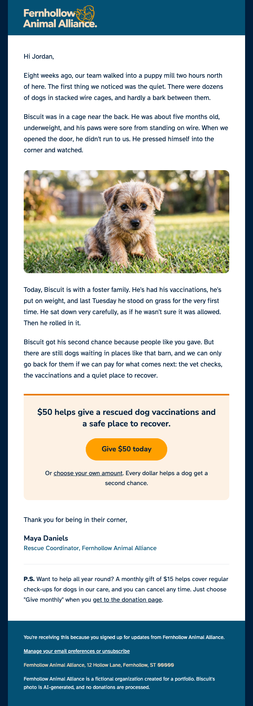
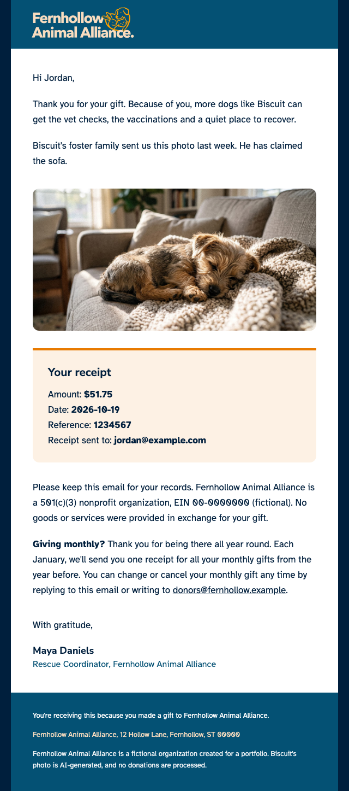

# Fernhollow Animal Alliance: appeal and receipt emails

Two emails for a fictional animal charity, written in MJML and built for Engaging Networks: a fundraising appeal and the receipt a donor gets after giving. They go with the [Second Chances donation page](https://shadelourens.github.io/fernhollow-portfolio/).

**[See the previews and screenshots](https://shadelourens.github.io/fernhollow-emails/)**

Built by **Shade Lourens** · [LinkedIn](https://www.linkedin.com/in/shadelourens)

> Fernhollow Animal Alliance is fictional, created for this portfolio. No donations are processed.

<p>
  
  
</p>

- **Ready to paste into Engaging Networks**, with editable blocks and a locked header and footer.
- **Tested in classic Outlook on Windows**, including a bug found in testing and fixed ([before](screenshots/inbox-appeal-outlook-windows-light-before-fix.png) and [after](screenshots/inbox-appeal-outlook-windows-light.png)).
- **Build checks that stop broken merge fields** before anything is saved.

## What's in it

1. **The appeal:** a marketing email telling Biscuit's story, with a $50 ask, A/B subject lines, three tracked links to the donation page and an unsubscribe link.
2. **The receipt:** a transactional email that's only about the gift: the amount, date and reference, a tax note, and how to change or cancel a monthly gift. No unsubscribe link and no marketing links, because receipts aren't marketing.

Each email comes in two versions:

- an **Engaging Networks version** with merge fields like `{user_data~First Name~Friend}`, ready to paste into the platform
- a **preview** with sample data ("Hi Jordan"), for test sends and the screenshots.

Both also have a **plain-text version**, written by hand with the same words and every link written out in full.

## How it's built

```
npm install
npm run build
```

The emails are written in [MJML](https://mjml.io), which turns simple tags into the table-based HTML email apps need. MJML is the only dependency. `build.js` then:

1. turns `src/appeal.mjml` and `src/receipt.mjml` into `dist/appeal.html` and `dist/receipt.html` (the Engaging Networks versions)
2. makes the previews by swapping each merge field for sample data, for both the HTML and the plain text
3. checks the merge fields **before saving anything**: every field must be there and written exactly right, any field that isn't on the list fails as a likely typo, and none can be left in the previews
4. prints each file's size and warns above 100KB, because Gmail cuts off emails bigger than about 102KB. The appeal is 26.9KB and the receipt 21.8KB.

If a check fails, the build stops and says what's wrong in plain words. The checks were tested by breaking a copy of the project on purpose: a typo, a changed ID and an unlisted field each stopped the build.

The header, footer and shared styles live in `src/layout/`, so both emails always match.

## Engaging Networks

### Merge fields

Every field was checked against Engaging Networks' own documentation or an email Engaging Networks built. None were guessed.

| Field                                   | Used in | Source                                                                                         |
| --------------------------------------- | ------- | ---------------------------------------------------------------------------------------------- |
| `{user_data~First Name~Friend}`         | both    | an Engaging Networks-built email                                                               |
| `{preview_text}`                        | both    | EN docs: Preview Text                                                                          |
| `{unsubscribe_action~ID~URL}`           | appeal  | an Engaging Networks-built email (the docs only describe the "Insert unsubscribe link" button) |
| `{user_data~Email}`                     | receipt | an Engaging Networks-built email                                                               |
| `{receipt_data~amount~[en]}`            | receipt | EN docs: Receipt Data Tags                                                                     |
| `{receipt_data~createdOn~[yyyy-MM-dd]}` | receipt | EN docs: Receipt Data Tags                                                                     |
| `{receipt_data~txId}`                   | receipt | EN docs: Receipt Data Tags                                                                     |

### Editable blocks

The templates are for Engaging Networks' **Marketing Tools** editor (Email Classic was retired in July 2026). Each text block has the `en__component--textblock` class and each photo `en__component--imageblock`, so an editor can change them. The letter sits in a droppable area, where new blocks can be dragged in, and each group (the story, the photo, the ask) is repeatable.

**The header and footer are locked on purpose.** They have no editable classes, so an editor can't remove the unsubscribe link or the postal address.

### Setting it up in Engaging Networks

- **Subject lines:** set up the appeal's A/B test in EN. A: "Biscuit had never stood on grass". B: "{first name}, can you give a dog a second chance?". The receipt's subject is "Your receipt from Fernhollow Animal Alliance".
- **Preview Text:** the appeal's is "He was five months old when we found him. Here's what happened next." The receipt's is "Thank you. Biscuit has something to show you."
- **Unsubscribe:** the template uses a fake ID (`00000`) and a fake address. Point it at the real **subscription management page**, which EN recommends for every unsubscribe link.
- **Date:** EN's docs only show the `yyyy-MM-dd` format, so that's what the template uses. Choose a US format such as "October 19, 2026" in EN's insert tool, instead of guessing the pattern.
- **Amount:** EN's docs don't show what the amount field outputs (for example, whether it includes the `$`). Check it with one test donation.
- **Plain text:** paste in `text/appeal.txt` or `text/receipt.txt`. EN can generate plain text from the HTML, but it doesn't update when the HTML changes later, and a hand-written version means the wording and the order of the links are chosen, not generated. EN's docs don't say how a field like `{unsubscribe_action}` comes out in plain text, so check it with one test send.
- **Monthly gifts:** EN's thank-you emails don't attach a receipt for recurring gifts. So the receipt tells monthly donors they'll get one yearly receipt each January, and how to change or cancel.

### Tracking links

Each link to the donation page has UTM tags with its own `utm_content` (`give-50-button`, `own-amount-link`, `ps-link`), so reports show which link was clicked.

In a real setup, the donation page would be an Engaging Networks page. Then each link would also be wrapped in `{campaignpage_url~ID~URL~Give_50_button}` and carry `en_og_source`, EN's Origin Source, which records where a new supporter came from. I left both out here because they only work on EN pages, and Origin Source codes must already exist in the account. My donation page is on GitHub Pages.

## Testing

| Where                                      | Appeal                                                                                                                                                                                                                                                                                  | Receipt                                                                                                                                                                                                  |
| ------------------------------------------ | --------------------------------------------------------------------------------------------------------------------------------------------------------------------------------------------------------------------------------------------------------------------------------------- | -------------------------------------------------------------------------------------------------------------------------------------------------------------------------------------------------------- |
| Browser                                    | [600px](screenshots/browser-appeal-600.png) · [320px phone](screenshots/browser-appeal-320.png) · [images off](screenshots/browser-appeal-images-off.png)                                                                                                                               | [600px](screenshots/browser-receipt-600.png) · [320px phone](screenshots/browser-receipt-320.png) · [images off](screenshots/browser-receipt-images-off.png)                                             |
| Gmail                                      | [web](screenshots/inbox-appeal-gmail-web.png) · [iPhone app](screenshots/inbox-appeal-gmail-app-light.png) · [dark mode](screenshots/inbox-appeal-gmail-app-dark-bottom.png)                                                                                                            | [iPhone app](screenshots/inbox-receipt-gmail-app-light-bottom.png) · [dark mode](screenshots/inbox-receipt-gmail-app-dark-bottom.png) · [images off](screenshots/inbox-receipt-gmail-app-images-off.png) |
| Apple Mail                                 | [Mac](screenshots/inbox-appeal-apple-mail-mac-light.png) · [Mac, images off](screenshots/inbox-appeal-apple-mail-mac-images-off.png) · [iPhone](screenshots/inbox-appeal-apple-mail-iphone-light.png) · [iPhone, dark mode](screenshots/inbox-appeal-apple-mail-iphone-dark-bottom.png) | Not tested (same layout as the appeal) |
| Outlook.com                                | [light](screenshots/inbox-appeal-outlook-web-light.png) · [dark mode](screenshots/inbox-appeal-outlook-web-dark-bottom.png) · [images off](screenshots/inbox-appeal-outlook-web-images-off.png)                                                                                         | [light](screenshots/inbox-receipt-outlook-web-light.png)                                                                                                                                                 |
| Classic Outlook on Windows (Microsoft 365) | [light](screenshots/inbox-appeal-outlook-windows-light.png) · [dark mode](screenshots/inbox-appeal-outlook-windows-dark.png) · [before the fix](screenshots/inbox-appeal-outlook-windows-light-before-fix.png)                                                                          | [light](screenshots/inbox-receipt-outlook-windows-light.png) · [dark mode](screenshots/inbox-receipt-outlook-windows-dark.png)                                                                           |
| Screen reader (VoiceOver on a Mac)         | Apple Mail and Safari: reads in the right order, and the button opens the donation page                                                                                                                                                                                                 | Safari: reads in the right order                                                                                                                                                                         |

I sent the test emails from a Mailgun sandbox and tested classic Outlook with Email on Acid (now part of Mailgun as Mailgun Inspect).

### What testing found

- **Classic Outlook cropped both photos and the header to a thin strip.** The images sat in text blocks with a 28px line height, and classic Outlook cuts an image to the line height around it. Giving the image blocks a normal line height fixed it.
- **The $50 heading and the button showed in Arial Black in classic Outlook.** Outlook uses Arial instead of Nunito Sans, and on Windows, Arial at weight 800 turns into Arial Black. Headings and the button now use weight 700.
- **Email on Acid's accessibility check** asked for a level-one heading, so the header logo is now the `<h1>`, and the $50 line and "Your receipt" are `<h2>`s. The one note left is the button's missing underline. That's on purpose: it's a filled button, so it clearly looks clickable.
- **"Missing SSL certificate" on the unsubscribe link** was a false alarm. The address was checked, and its HTTPS works.
- **Spam checks passed everywhere except Yahoo.** Yahoo's filter looks at the sender's reputation and email authentication, which a Mailgun sandbox doesn't have, rather than the content.
- **Dark mode:** Apple Mail keeps the design as it is. Gmail, Outlook.com and classic Outlook darken it themselves, and the button turns dark orange with light text, which is still readable. The header looks the same everywhere, because the logo and its teal are one image.
- **Outlook.com only shows the navy background when the reading pane is wider than the email.** In a narrow pane there's no room for it. That's not a bug.
- **Gmail turns the donor's email address into a link**, and with images off it shows an empty frame for the photo instead of its alt text. Neither breaks anything.
- **VoiceOver reads the appeal in the right order** in Apple Mail and Safari: the email's name ("Biscuit had never stood on grass"), then "heading level 1, Fernhollow Animal Alliance, image", the first two paragraphs, Biscuit's photo with its alt text, and the rest. The "Give $50 today" button opens the donation page. In Apple Mail, step into the email first (VO + Shift + Down Arrow), then move through it with VO + Right Arrow. The receipt also reads in the right order in Safari.

### Test sends

I ran every test send myself. The Mailgun key only ever lives in an environment variable on my computer, and `read -s` keeps it off the screen and out of the terminal history. This is for zsh, the Mac's default shell. In bash, the first line is `read -s -p "Mailgun key: " MAILGUN_API_KEY && export MAILGUN_API_KEY`.

```bash
read -s "MAILGUN_API_KEY?Mailgun key: " && export MAILGUN_API_KEY

curl -s --user "api:$MAILGUN_API_KEY" \
  https://api.mailgun.net/v3/YOUR-SANDBOX-DOMAIN/messages \
  -F from="Maya at Fernhollow <postmaster@YOUR-SANDBOX-DOMAIN>" \
  -F to="YOUR-TEST-INBOX" \
  -F subject="Biscuit had never stood on grass" \
  -F html="<dist/appeal-preview.html" \
  -F text="<dist/appeal-preview.txt"
```

The `<` sends what's inside each file, so the HTML and the plain text go in the same email, the way real platforms send. Email apps that can't show HTML fall back to the text.

## Accessibility

- `lang="en"`, a `<title>`, a hidden preheader, and real headings: the logo is the `<h1>`, and the $50 line and "Your receipt" are `<h2>`s.
- Every image has alt text. The header's alt text is styled in peach on teal, so it still reads like a heading when images are blocked.
- Real text everywhere, apart from the logo.
- Body text is 16px or larger, and footer text 13px or larger.
- Every text color pair is at least 6.6:1 contrast, well above the 4.5:1 minimum. Orange is only used for lines, never text.
- Links are underlined and say where they go, apart from the button.
- Works on a 320px phone, and every email has a plain-text version.
- Tested with VoiceOver: both emails read in the right order, and the button can be reached and used.

## Decisions worth mentioning

- **The logo and its teal background are one image**, so no email app can change one color and not the other in dark mode.
- **Images are written by hand inside text blocks.** MJML's image tag fixes the height in pixels, which squashes photos on phones. Width and height are still set, for Outlook.
- **Photos are twice the size they're shown at and under 200KB**, so they're sharp without slowing the email down.
- **The receipt says "receipt" in the subject**, because donors search their inbox for it at tax time. It uses US wording: "a 501(c)(3) nonprofit organization" and "No goods or services were provided in exchange for your gift."
- **The preview's unsubscribe link goes to [a short note](https://shadelourens.github.io/fernhollow-emails/#unsubscribe)** explaining the demo, instead of linking nowhere.
- **Fake IDs and reserved `.example` addresses** (`act.fernhollow.example`, `donors@fernhollow.example`), so nothing points at a real organization.

## How I worked with AI

Claude Code wrote the plans and the code. Before approving anything, I had a separate Claude conversation review each plan, then decided what to accept, change or reject. For example, I kept the header as one image instead of splitting it, chose to verify every merge field in EN's docs rather than guess, and held back the US date format because EN's docs didn't confirm it. I ran every test myself: test sends, inbox screenshots and Email on Acid, which is where I found the classic Outlook crop.

The commits are co-authored with Claude, so the history shows how the work was done. [`NOTES.md`](NOTES.md) records what I asked for and why I made each decision, and [`CLAUDE.md`](CLAUDE.md) holds the project rules I gave Claude Code.

## What I'd do next

- **Connect a real Engaging Networks account** to confirm how the amount, the date and the plain-text fields come out.
- **Send from an authenticated domain** instead of the sandbox, which should fix the Yahoo spam result.
- **Run the A/B subject test with real sends** and compare the open and click rates.

## Files

```
src/
  layout/          shared head and styles, header and footer
  appeal.mjml      email 1
  receipt.mjml     email 2
text/              plain-text versions, written by hand
build.js           builds both emails and checks the results
dist/              built HTML and previews (generated, never edited by hand)
assets/            header image and Biscuit's photos
screenshots/       browser and inbox screenshots
index.html         the project page on GitHub Pages
NOTES.md           my working notes
CLAUDE.md          project rules for Claude Code
```

## Credits

- [MJML](https://mjml.io), under the MIT License.
- Fonts: [Nunito Sans](https://fonts.google.com/specimen/Nunito+Sans) and [Atkinson Hyperlegible](https://www.brailleinstitute.org/freefont/), both under the SIL Open Font License.
- Biscuit's photos: AI-generated with Google Gemini, so the emails don't use a real charity's photos or a real animal. Biscuit, like Fernhollow, is fictional.
- Test sends with [Mailgun](https://www.mailgun.com), and client testing with [Email on Acid](https://www.emailonacid.com).
